# 添加游戏

软件提供多种方式添加游戏。前两种需要配合 `source_url.txt` 文件（内容为游戏对应的帖子链接），其余方式为直接添加本地文件夹，并可选择从 DLsite / Steam 云端刮削导入。

「游戏」页面现有「添加单个游戏」和「批量添加游戏」两个按钮。部分截图来自旧版，按钮位置与图标以当前软件为准。

## 方式一：内置解析器站点下载的游戏

支持站点：**ACG嘤嘤怪、飞雪ACG、维咔ACG**。

1. 在游戏目录下新建一个文本文件，命名为 `source_url.txt`

2. 在文件中填入该游戏对应的帖子链接，例如：

   ```
   https://www.vikacg.cc/p/567658
   ```

   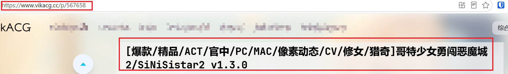

3. 将 `source_url.txt` 放在游戏启动文件（.exe）的**同级目录**，或游戏目录内的 `HGMDatas/` 下：

   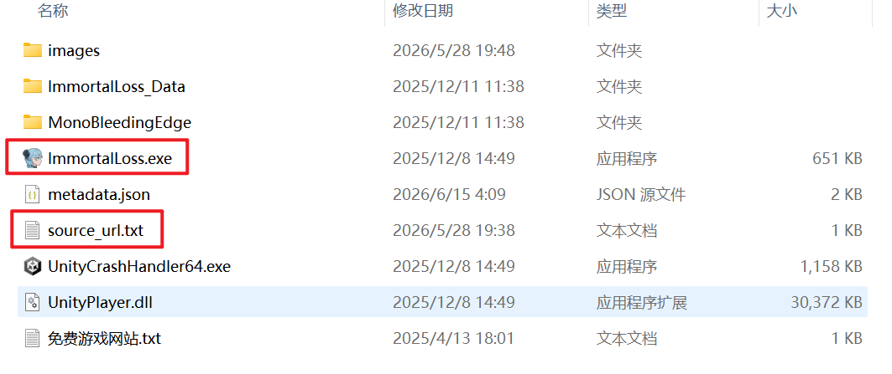

4. 回到软件，进入「刮削」页面 → 扫描游戏库 → 刮削元数据。抓取完成后，在确认表单中核对并保存结果。

### 批量刮削后确认

刮削中心和 Steam/DLsite 批量添加会先取得候选资料，随后打开「确认刮削结果」。列表同时显示原游戏和候选标题，右侧可查看来源、简介、标签与图片。

1. 点击条目查看资料，用「保留此项」或「放弃此项」逐项判断；判断后会自动前进到下一项。
2. 也可勾选多个条目，使用「保留所选」或「放弃所选」。
3. 点击「保存已保留」应用已确认的资料。放弃的条目保留游戏原有资料和文件。
4. 需要集中整理时，勾选条目并填写或选择目标文件夹，再点「移动所选」。每个游戏保留自己的子目录；同名目标会提示冲突。

「选择放弃和失败项」可快速选中需要后续处理的游戏，移动到自行准备的“未完成刮削”文件夹。已标记保留的条目需要先保存再移动。如果启用了自动重命名或整理，确认表单中可决定本次保存是否使用该设置。

关闭表单后，本次运行中的结果仍可从刮削中心「确认刮削结果」继续查看；待确认列表保存在内存中，退出应用后需重新抓取。保存失败会显示具体原因，图片下载不完整时会恢复原资料，待网络恢复后再保存。

确认期间如果游戏已由其他入口入库，或记录、目录发生变化，需要重新抓取后确认，避免将旧候选写入已变化的记录。

抓取失败时，刮削中心可编辑对应条目的来源后再次点击「刮削元数据」；仍有其他待确认结果时只重试失败项。批量添加可直接修改失败项的来源和关键词或作品 ID，再点「重试失败项」。

## 方式二：其他 ACG 站点（自定义解析器）

除了内置站点外，你也可以添加其他 ACG 站点的游戏，但需要先配置自定义解析器。

**准备工作：**

1. 在游戏目录下同样创建 `source_url.txt`
2. 在软件内点击「设置」→「刮削」→「自定义解析器」→「添加站点」，弹出页面如下：

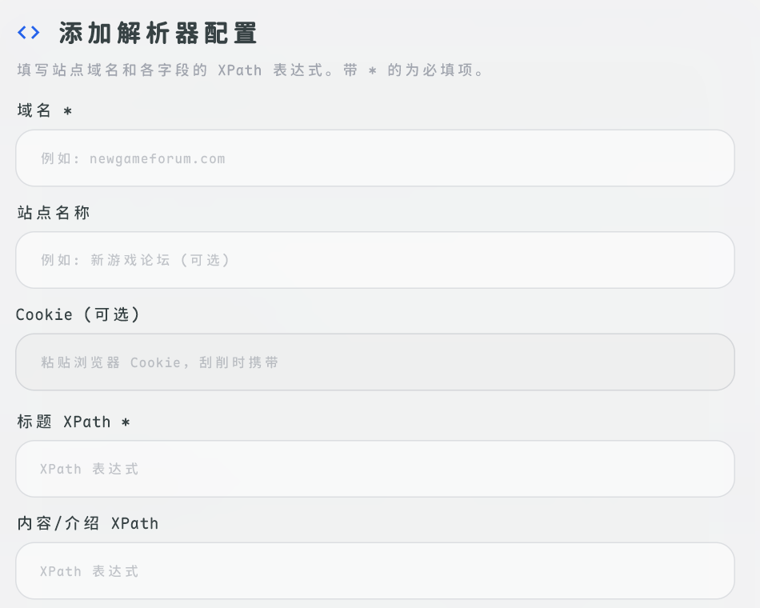

### Step 1 - 填写域名

打开帖子页面，复制浏览器地址栏中 `http://` 后面的域名部分（如 `acgcu.com`），粘贴到自定义解析器的「域名」栏。

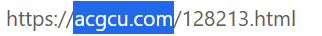

### Step 2 - 获取 Cookie

在帖子页面按 <kbd>F12</kbd> 打开开发者工具 → 点击「网络」→ 点击「文档」（或者是 document）→ 刷新页面。在请求列表中点击任意一条请求，复制其 Cookie 值，粘贴到软件的 Cookie 栏。

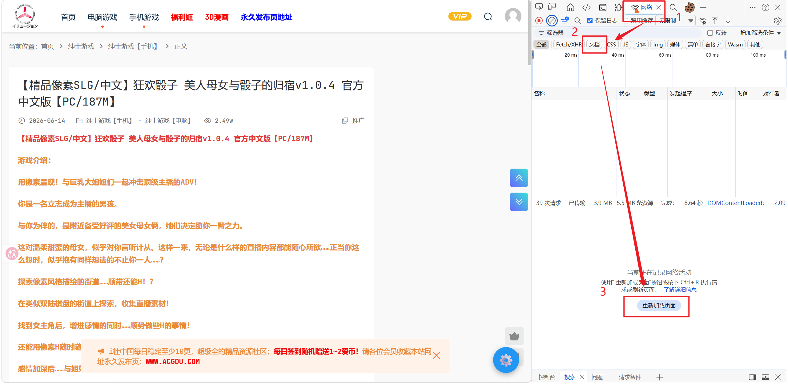

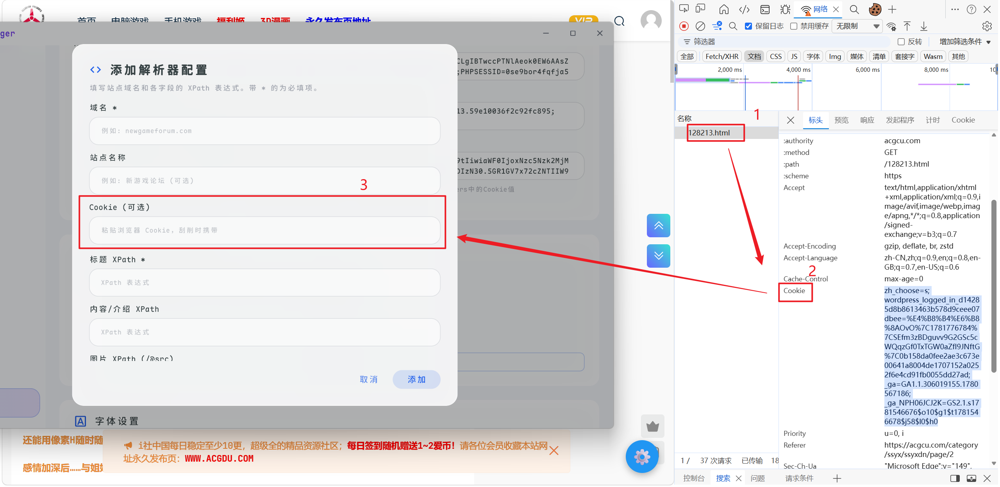

### Step 3 - 获取标题 XPath

点击开发者工具左上角的「选择元素」按钮，然后点击帖子标题。在右侧代码区域找到高亮（灰色）的那段代码，右键 → 复制 → 复制完整 XPath，粘贴到「标题 XPath」栏。

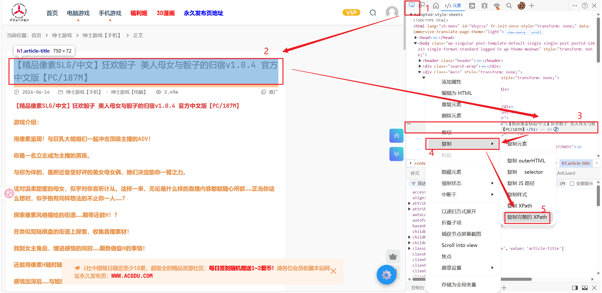

### Step 4 - 获取介绍 XPath

用同样方式选中游戏介绍内容（注意蓝色框要覆盖全部介绍文字，而非仅一小段），右键灰色代码 → 复制 → 复制完整 XPath，粘贴到「内容/介绍 XPath」栏。

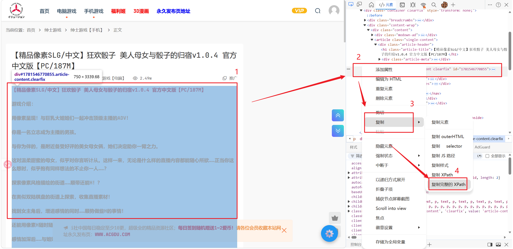

### Step 5 - 保存

填写完成后保存即可。同一站点只需配置一次，后续无需重复添加。

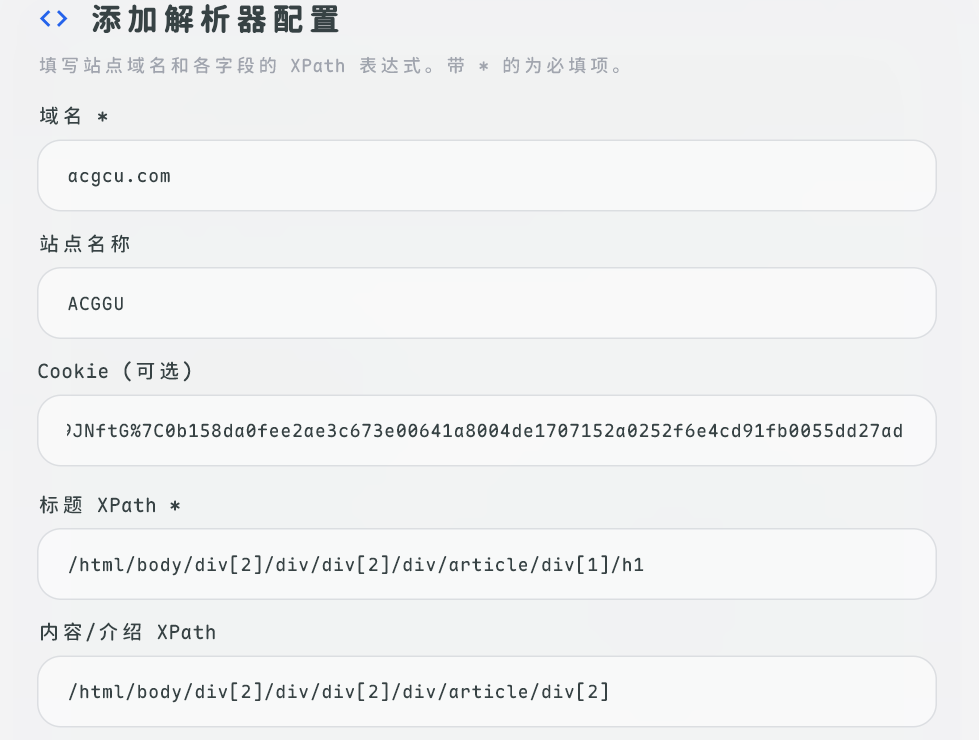

::: tip
配置好自定义解析器后，回到刮削中心即可正常刮削该站点的游戏信息。
:::

## 方式三：直接添加本地游戏

如果不想配置以上内容，或者自定义解析器无法使用，可以直接添加本地文件夹。

1. 进入软件的「游戏」页面
2. 点击右上角的「添加单个游戏」（加号）按钮
3. 选择「不刮削」，浏览并选择游戏本身所在的文件夹，点击导入

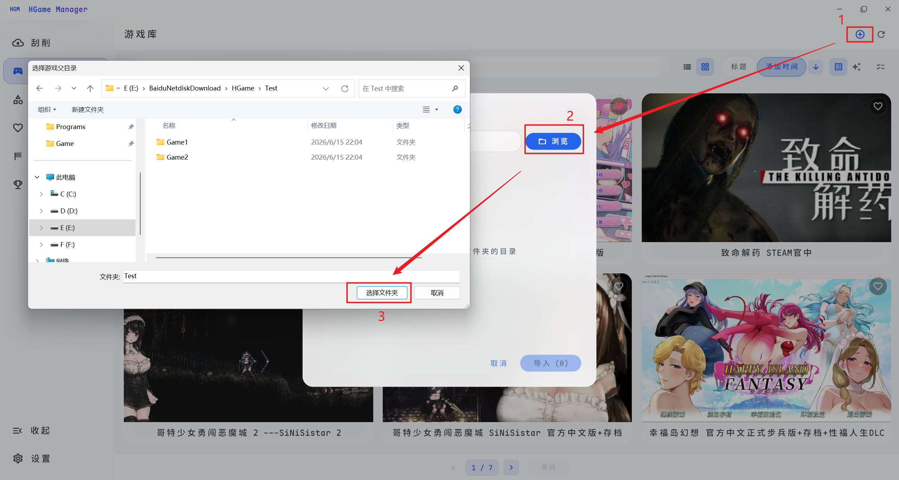

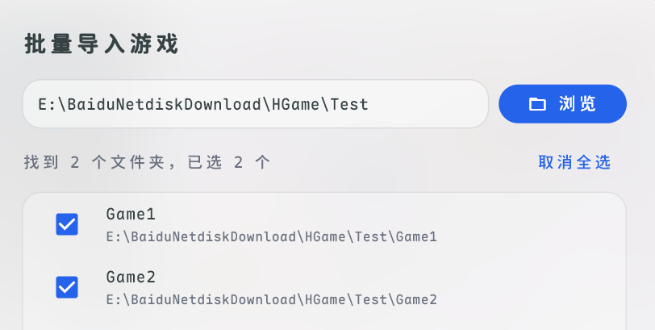

::: tip 批量添加
一次添加多个游戏时，使用「批量添加游戏」并选择包含这些游戏文件夹的父目录。例如 Test 下有 Game1、Game2，批量添加时选择 Test；单个添加 Game1 时直接选择 Game1。
:::

单个添加和批量添加会跳过已入库的目录，批量结果分别显示成功、跳过和失败数量。同一批次的重复路径只处理一次；路径比较忽略 Windows 下的大小写、分隔符、末尾分隔符和 `.` / `..` 差异，保留原记录及其个人数据。需要更新已有游戏信息时，请在详情页使用刮削功能。

### 优化显示

导入本地游戏后，在游戏详情页点击右上角「管理图片」可以导入本地图片或网络图片：

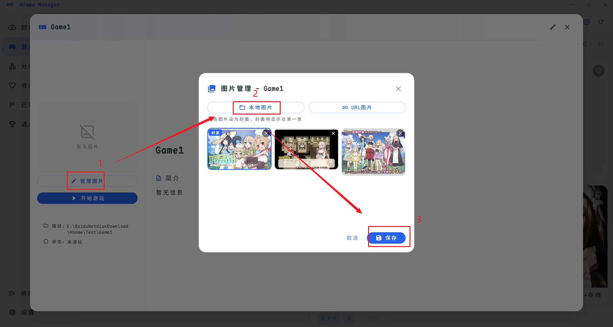

随后可以自己「编辑」信息，简介内部也能「插入」你所添加的图片：

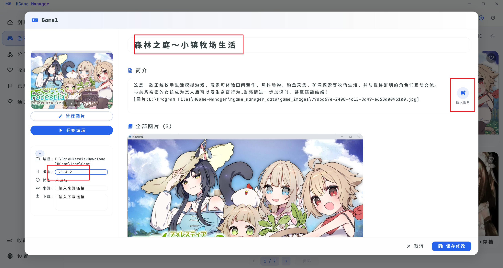

效果展示：

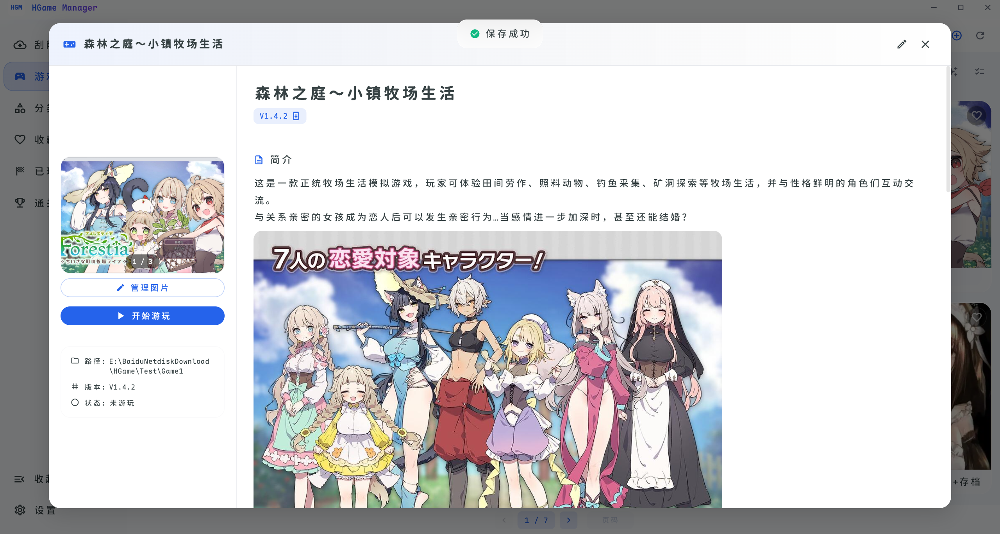

### 快速导入技巧

导入本地游戏后，在游戏详情页点击右上角「编辑」可以修改来源链接。如果填入的链接域名匹配自定义解析器或内置站点，回到刮削中心即可重新刮削。这样可以跳过手动创建 `source_url.txt` 的步骤。

::: tip 提示
刮削中心扫描时默认跳过已刮削的游戏（按 metadata.json 中的 `scraped_at` 标识判断）。如需对已刮削的游戏重新刮削，请先在刮削页勾选「包含已刮削的游戏」。
:::

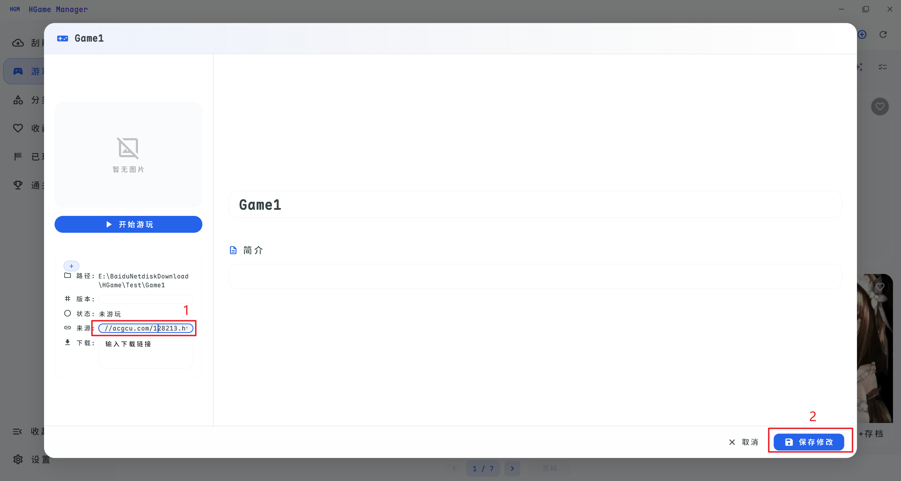

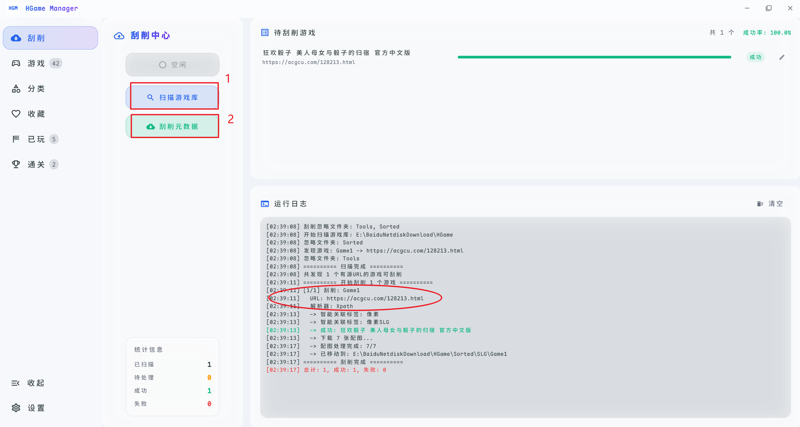

## 方式四：导入本地游戏并从 DLsite 刮削信息

1. 切换到「游戏」页面
2. 点击右上角的「添加单个游戏」（加号）按钮，选择 DLsite
3. 选择游戏文件夹
4. 搜索（如果你知道 ID 可以自己输入）
5. 选中游戏
6. 导入选中

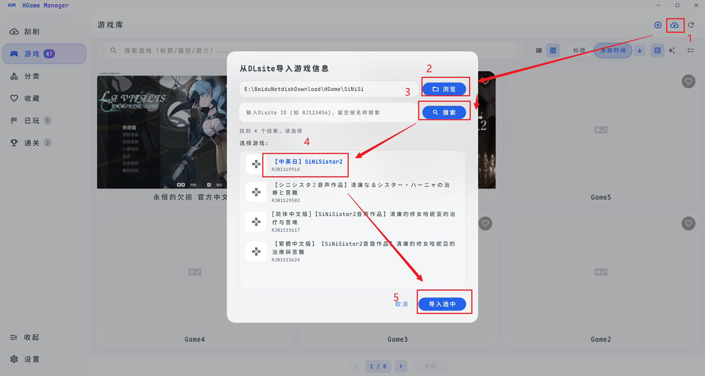

## 方式五：导入本地游戏并从 Steam 刮削信息

- 从 Steam 找到游戏位置（找到游戏右键 → 管理 → 浏览本地文件）

  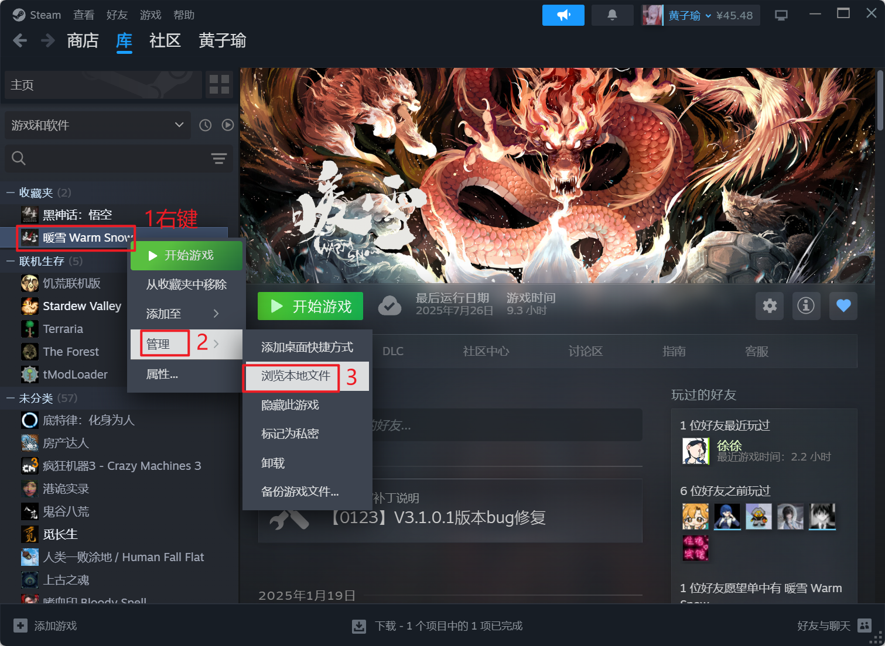

- 选中地址栏复制

  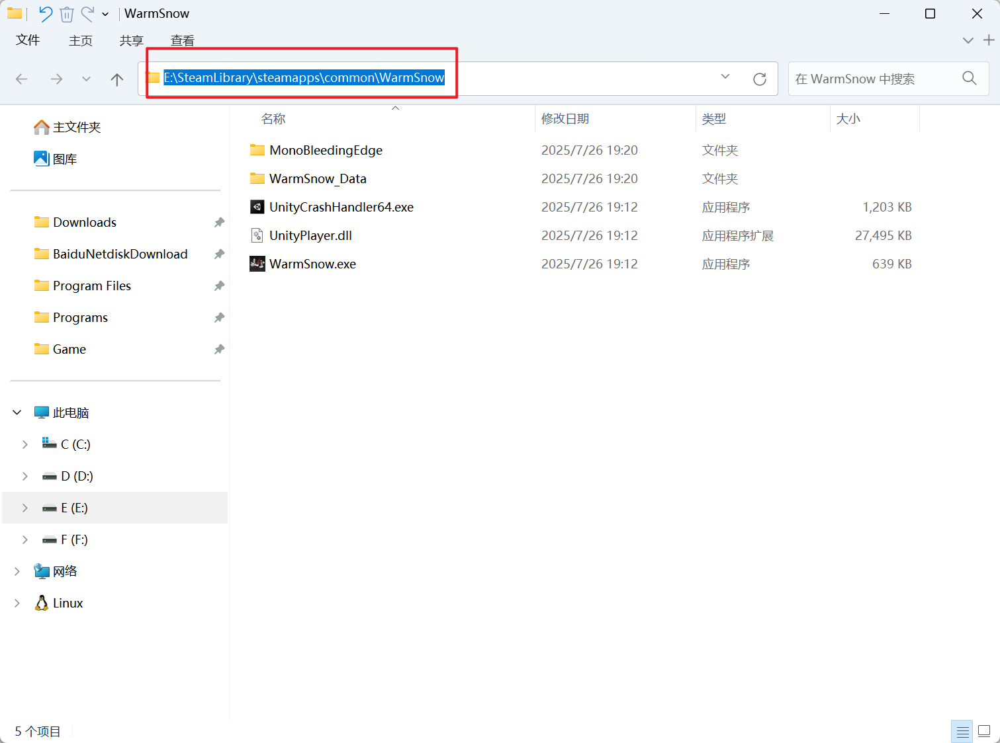

- 回到软件点击右上角的「添加单个游戏」（加号）按钮，切换到 Steam 选项
- 复制地址选择游戏文件夹
- 搜索 → 选中游戏 → 导入选中

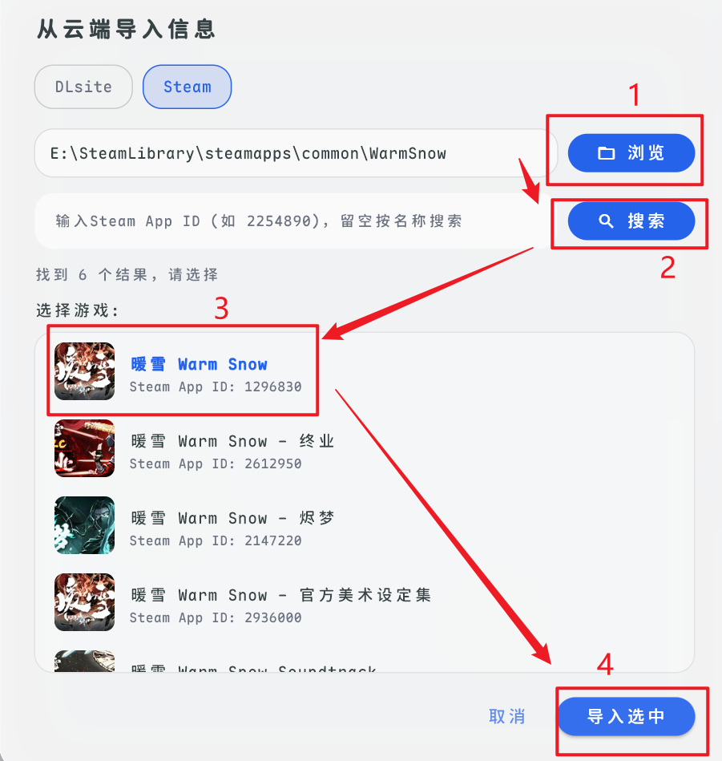


## 方式六：批量导入并自由选择从Steam/DLsite刮削信息

- 点击「游戏」页面右上角的「批量添加游戏」按钮并选择父文件夹（该文件夹需要包含你的多个游戏）

  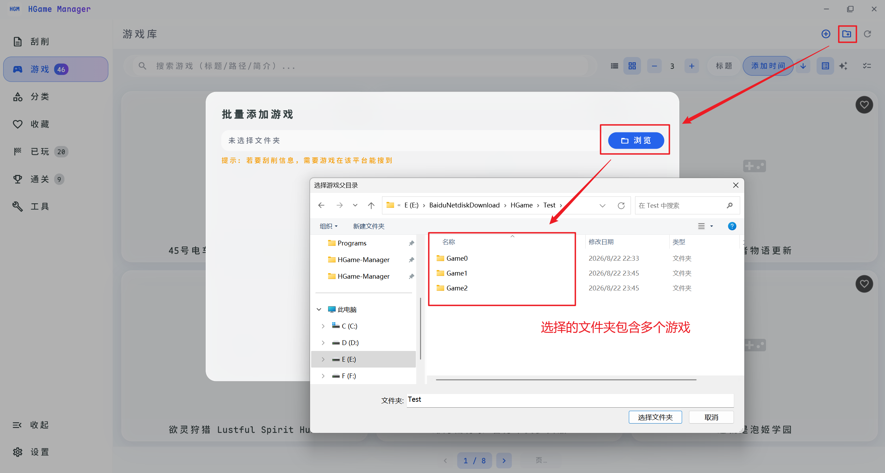

- 在弹出的窗口可以自行选择该游戏是否从 Steam/DLsite 刮削信息（需要该游戏本身能够从该渠道获取到信息）或是不导入信息，同时修改更准确的游戏名称（不修改默认以文件夹名为关键词搜索）

  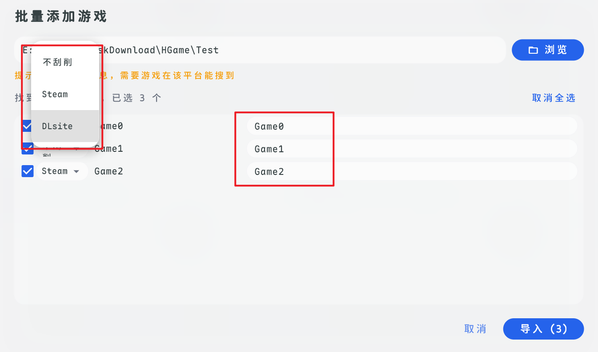

- 点击「开始」后，Steam / DLsite 先抓取候选资料；抓取完成会自动打开「确认刮削结果」。
- 已入库的目录和本批次重复目录会自动跳过，完成后分别显示成功、跳过和失败数量。
- 逐项或批量标记「保留 / 放弃」，再点「保存已保留」。放弃的游戏保持原资料，也可选中移动到指定文件夹。
- 关闭确认表单后，可在批量添加窗口底部点击「确认刮削结果」继续处理。

## 方式七：拖入文件夹快速添加

最快捷的添加方式：直接从资源管理器把游戏文件夹**拖入软件窗口的任意位置**。

- 拖入 1 个或多个文件夹 → 打开同一个批量添加窗口，按实际数量列出游戏
- 也可以直接拖入游戏的 `.exe` 文件：软件会把它所在的文件夹作为游戏目录，并自动用 exe 文件名作为刮削搜索关键词

  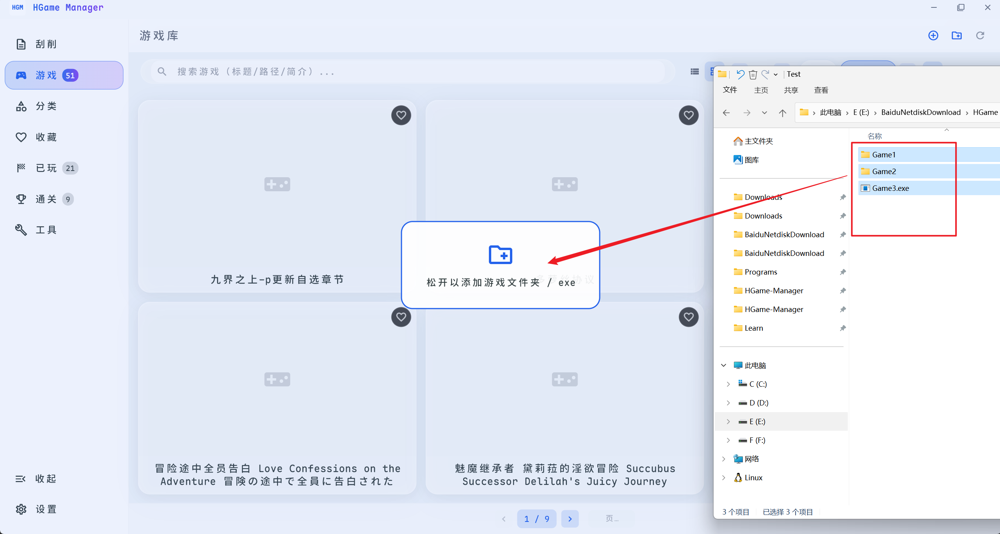

拖入后弹出与「方式六」相同的窗口，可为每个游戏选择刮削源（Steam / DLsite / 不刮削）并修改搜索关键词，确认后开始导入。

::: tip
拖入已在库中的文件夹会在导入时自动跳过，不会重复添加。
:::

## 刮削后自动翻译

在「设置 → 刮削 → 元信息自动翻译」中开启「刮削后自动翻译为简体中文」，卡片内会展开服务选择和对应配置。选择 LLM 后显示接口、模型、密钥及提示词；切换服务或暂时关闭开关会保留已填内容。点击设置页底部「保存」后生效。快速刮削、重新刮削、刮削中心和 Steam/DLsite 的单个、批量导入共用此配置。

- **Google 翻译**：无需填写密钥，使用软件的网络代理设置。可先点击「测试连接」确认网络可用。
- **LLM（OpenAI 兼容接口）**：填写接口地址、模型名称和服务所需的 API Key。地址支持 `https://服务地址/v1` 或完整的 `/chat/completions` 地址；本地服务无需鉴权时，API Key 可留空。
- **翻译 Prompt**：选择 LLM 后可填写自己的翻译要求，例如用词风格、专有名词处理等。留空时，输入框显示默认提示词，翻译也使用该默认值；自定义内容会随设置保存。「测试连接」使用当前填写的 Prompt。

「测试连接」只检查当前选择的服务，使用当前填写的配置，最多等待 20 秒。测试时会显示等待提示，超时后可重试；切换配置会结束本次测试。

翻译会把上述文字发送到所选服务。LLM 不可用时自动尝试 Google，完成提示会说明兜底情况；两种服务都失败时保留原文，并提示检查网络或稍后重试。批量导入和刮削中心会保留每个游戏的翻译提示，可在确认结果中查看。

翻译完成后，详情页标题下会出现「查看原文」按钮，点击后可用「查看译文」切回。切换仅改变当前显示，不会再次请求翻译，也不会改动已保存的译文。原文保存在游戏的 `HGMDatas/metadata.json` 中，随游戏目录整理和搬运一同保留。编辑功能修改当前保存的译文。

标记通关时，原文和富文本会同时保存到通关元数据备份。通过软件删除本地游戏文件夹并保留通关记录后，仍可在详情页查看原文；删除前尚未保存到备份的历史原文无法补回。

默认关闭自动翻译。启用后对下一次刮削生效；已有游戏可重新刮削后获得译文。
