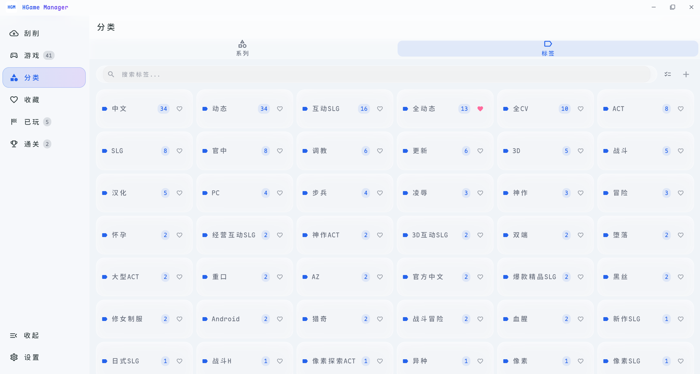
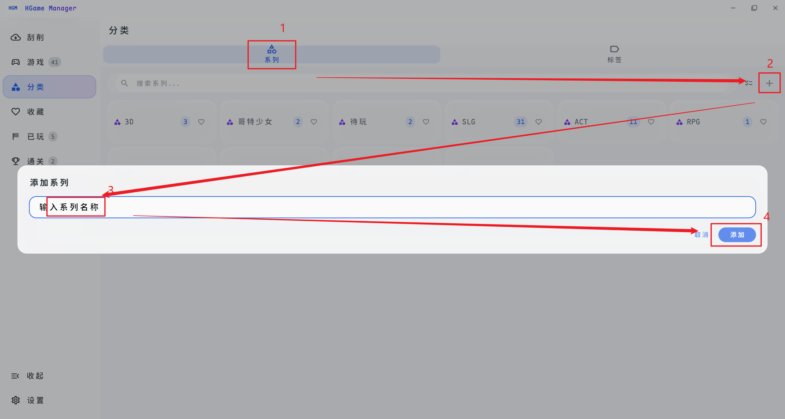
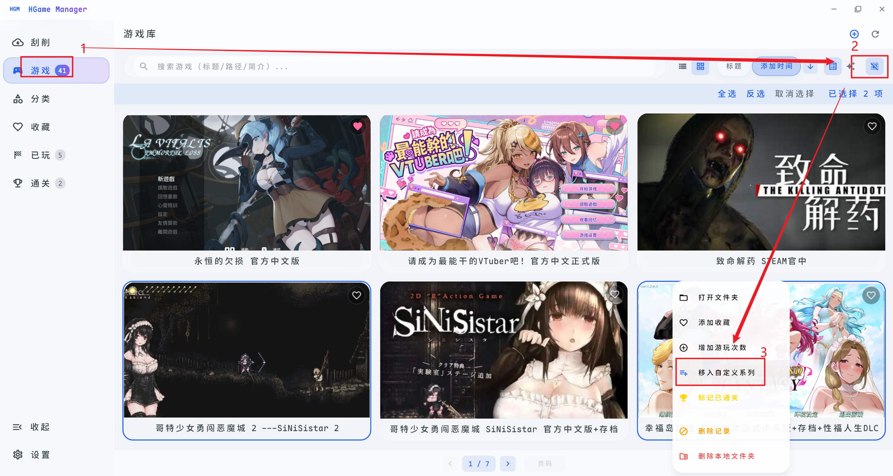
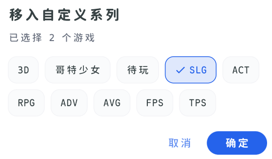

# 分类管理

软件在刮削时会自动生成标签。你也可以在游戏详情中自行添加标签，或通过「系列」功能自定义分类。



## 添加或修改游戏标签

1. 打开游戏详情，在资料卡的「标签」旁点击「编辑标签」。
2. 输入标签名称后按回车，或使用逗号分隔多个名称；点击「已有标签」可直接选用。
3. 点击已选标签上的删除按钮可移除该游戏的标签。
4. 点击「完成」保存。点击「取消」会保留原标签。

同名标签会去重；普通标签的修改保留游戏已有的系列。也可以点击详情顶部的「编辑」，在标签区域点击「添加标签」，最后点击「保存修改」。

保存后标签同时写入应用数据库和游戏目录的 `HGMDatas/metadata.json`，游戏列表与分类页面会立即更新。

### 手动修改 JSON 后如何更新

游戏列表读取应用数据库。手工修改 `HGMDatas/metadata.json` 后，需要点击游戏页面右上角的「刷新」，让扫描服务把元数据重新同步到数据库；仅重启应用不会主动重新导入。

普通标签填写在 `tags` 字段中，使用字符串数组，例如：

```json
{
  "tags": ["剧情", "像素风", "待游玩"]
}
```

重新扫描会同步新增和移除的普通标签；系列使用独立的 `series` 字段。日常修改建议使用详情页的「编辑标签」，保存后即可看到结果。

## 创建自定义系列

1. 切换到「系列」
2. 点击右上角的「+」按钮



::: tip
添加标签或系列时支持连续输入：输入名称后按回车即可继续添加下一个，也可以用逗号一次分隔多个名称。
尚未关联游戏的标签也会保留并显示，需要时可通过右键菜单手动删除。
:::

## 排序方式

页面右上角可切换「按数量 / 自定义」排序：

- **按数量**：默认方式，游戏数量多的标签 / 系列排在前面
- **自定义**：直接拖拽卡片到目标位置即可调整顺序，其它卡片会自动让位，顺序会被记住

在「按数量」模式下拖拽卡片会自动切换为自定义排序。

## 将游戏移入系列

1. 回到「游戏」页面
2. 勾选想要归类的游戏
3. 右键点击游戏 → 选择「移入自定义系列」
4. 在弹窗中选择目标系列，点击确定




