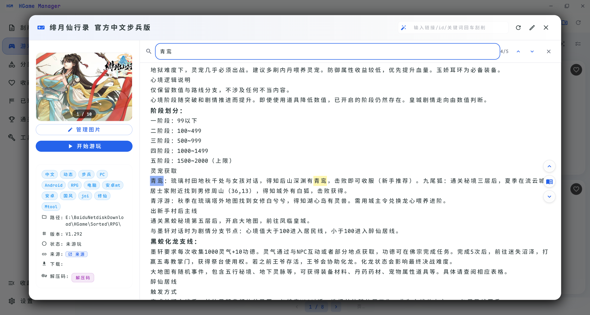
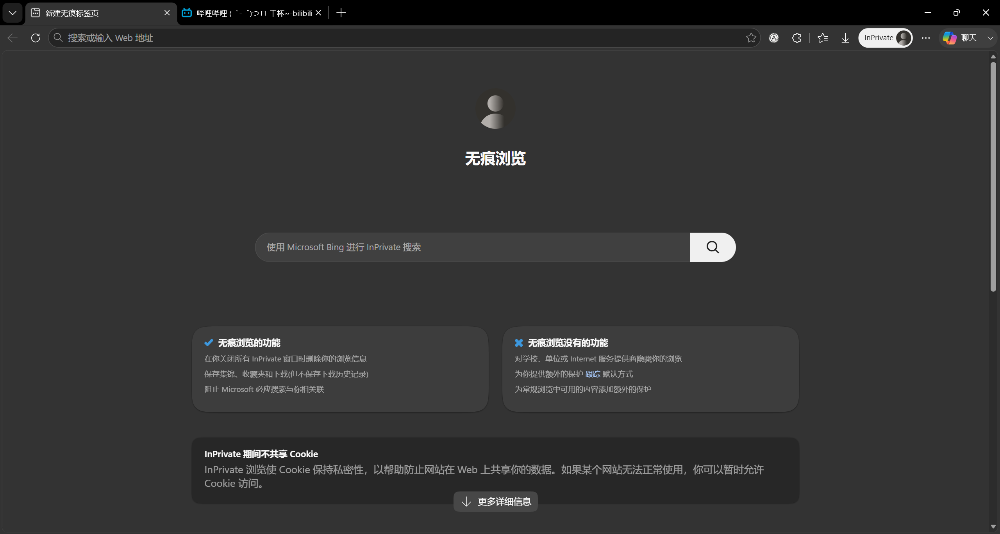
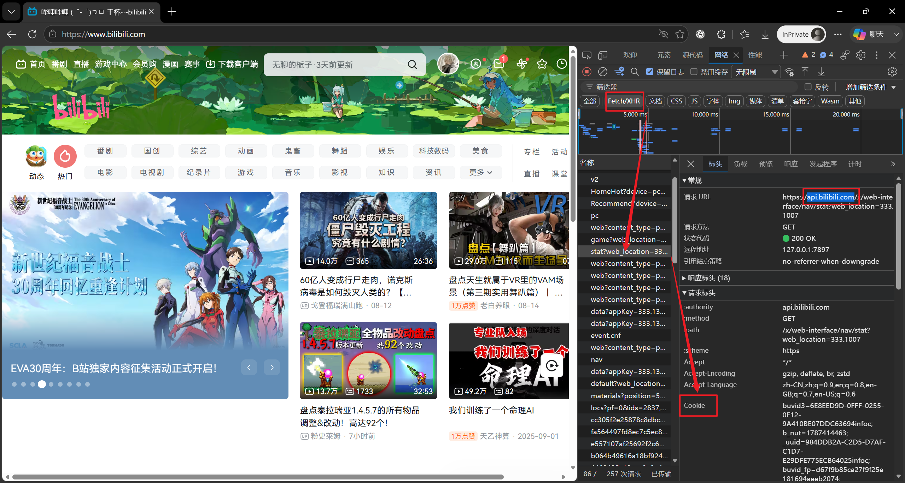
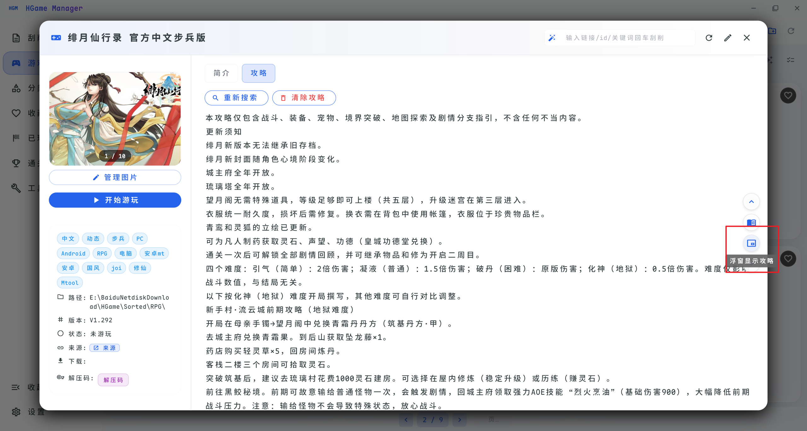
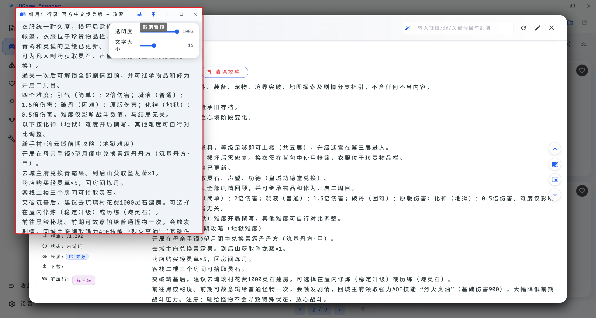

# 攻略管理

软件支持在 `游戏详情页` 设置攻略，支持手动填写和自动搜索导入（2DFan/bilibili），并自动记忆上次浏览位置，可以通过 `Ctrl + F` 进行搜索跳转

## 导入攻略

在详情页打开攻略搜索窗口，选择 2DFan 或 pilipili（bilibili），输入关键词并选择结果。2DFan 如返回多个攻略章节，还需选择具体章节。

使用 pilipili 搜索时，可在设置中填写当前登录会话的 Cookie：

1. 在浏览器中打开 bilibili 并登录账号。普通窗口或无痕窗口均可，软件不要求无痕模式；Cookie 有效期由站点登录状态决定。

    

2. 按 `F12` 打开开发者工具，刷新网页
3. 在「网络（Network）」中找到 `api.bilibili.com` 的请求，打开「请求标头（Request Headers）」并复制 Cookie；若「文档」筛选下没有请求，可切换到「全部」或「Fetch/XHR」

    

4. 找到软件内的「设置」页面的「刮削」选项，将刚才的cookie填入「pilipili」栏，并点击「保存」

此时回到「游戏详情页」，点击右侧的「攻略」按钮，选择「pilipili」搜索关键词并点击，软件会自动导入攻略

如果提示登录状态失效或请求受限，重新登录并更新 Cookie，或稍后重试。取消搜索不会删除原攻略配图；成功导入新攻略后才清理未引用的旧图。

## 攻略浮窗

游戏时想对照攻略？在详情页攻略 Tab 下，点击右侧悬浮按钮栏的「浮窗显示攻略」，攻略会在独立小窗口中打开，可置顶于游戏画面上。

- 浮窗可自由拖动、调整大小，位置、置顶状态、透明度、文字大小与滚动进度均自动记忆
- 点击标题栏左侧的调节按钮可拖动调整透明度与文字大小，点击其他区域自动保存收起
- 全局快捷键（游戏中同样生效）：`Ctrl + 1` 开启/关闭浮窗，`Ctrl + 2` 切换置顶，`Ctrl + ↑/↓` 上下滚动
- 快捷键可在「设置 → 管理 → 攻略浮窗快捷键」中自行修改
- 如快捷键未生效，检查「设置 → 通用 → 注册全局攻略浮窗快捷键」是否启用，以及是否与其他程序冲突

    
