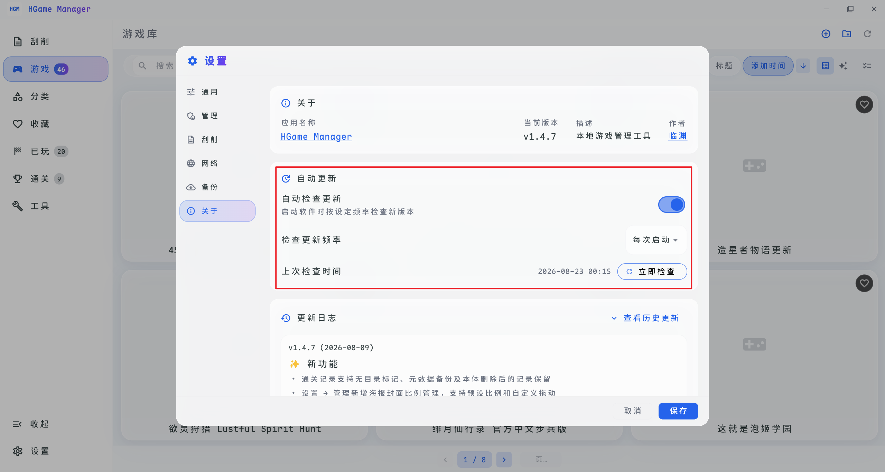
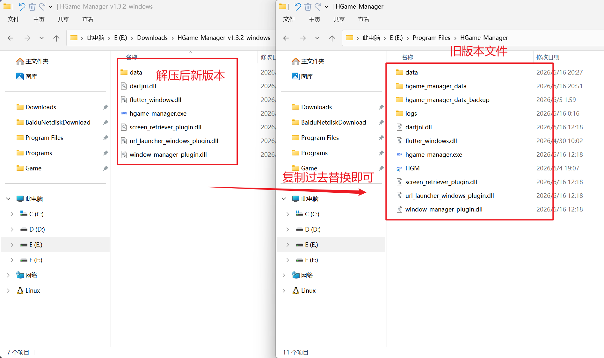
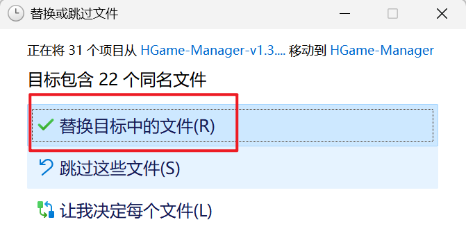

# 软件更新

## 方式一：自动更新

打开软件的「设置」页面，点击「关于」选项卡，可以自行设置是否自动检查更新以及频率，有新版本则会弹出更新提示框。

::: tip
即使不设置自动检查更新，也能够点击「立即检查」按钮进行手动检查更新
:::

## 方式二：手动更新

先关闭软件，再将新版本完整解压到旧目录并**替换**程序文件。请保持 DLL 和 `data/` 等文件齐全，不要只复制 EXE。

::: tip
软件的数据（游戏库、配置等）存储在 EXE 同级的 `hgame_manager_data` 目录中，更新时保留此目录。游戏元数据和存档备份另存在各游戏的 `HGMDatas` 中。建议更新前在「设置 → 备份」导出游戏库，或关闭软件后复制完整数据目录。
:::
