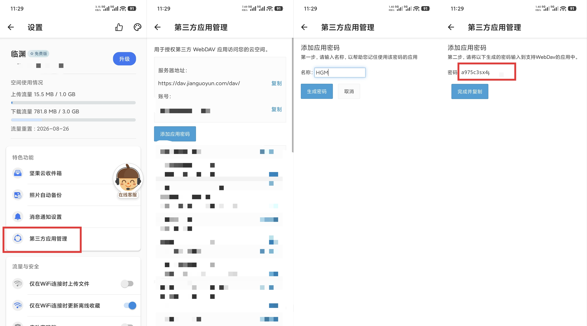
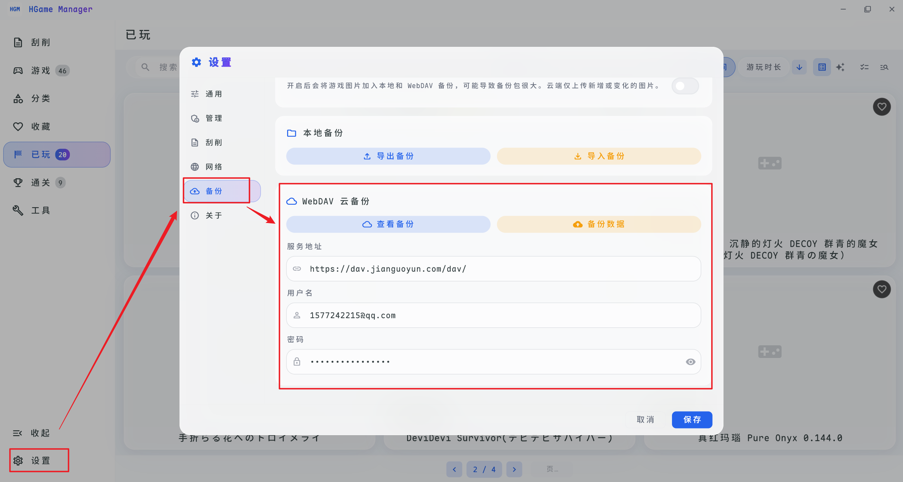

# WebDAV

软件可连接支持 WebDAV 的服务器。以下以[坚果云](https://www.jianguoyun.com/)为配置示例，其他服务也类似；套餐额度、收费和使用限制以服务商当前说明为准。

## 获取 WebDAV 信息

1. 打开坚果云APP并登录账号
2. 打开设置页面
3. 点击「第三方应用管理」
4. 点击「添加应用密码」
5. 填写应用名称（自定义即可），并点击「生成密码」
6. 复制生成的密码

## 填写 WebDAV 信息

打开软件的「设置」页面，点击「备份」选项卡，将上一步获取到的WebDAV信息填写到输入框中（服务地址固定为: https://dav.jianguoyun.com/dav/ ）。

## 游戏库备份与游戏存档

- 「设置 → 备份」保存的是游戏库数据库、设置和可选图片，不包含游戏本体或游戏存档；图片支持增量上传。
- 单个游戏的存档在详情页「存档管理」中备份、上传和还原，详见[存档管理](/guide/saves)。
- 导入游戏库备份前会校验数据库和设置，失败时回滚；如回滚未完成，会提示恢复文件所在位置。导入成功后按提示重启软件。
- 下载使用临时文件，完整接收后才替换目标；支持中文和特殊文件名，以及服务器返回的 gzip 压缩响应。
- 依赖 WebDAV 增量图片的备份应从 WebDAV 备份列表导入；仅把 ZIP 下载后本地导入，可能缺少云端图片。
